<h3><code>mano@github ~ $ ./contributions.sh</code></h3>

  
<h3><code>mano@github ~ $ whoami</code></h3>
<table><tr>
<td valign="top"></td>
<td valign="top"></td>
</tr></table>
 
<a href="https://github.com/Mano090">github.com/Mano090</a>

