<h3><code>mano@github ~ $ ./contributions.sh</code></h3>

  
<h3><code>mano@github ~ $ whoami</code></h3>
<table><tr>
<td valign="top"></td>
<td valign="top"></td>
</tr></table>
 
<strong>Fullstack Developer · AI Builder</strong> 
I build websites, create AI-powered tools, and teach others to bring their ideas to life through code.  
<code>HTML · CSS · JavaScript · Python · PHP · Node.js · SQL · OpenAI API</code>

